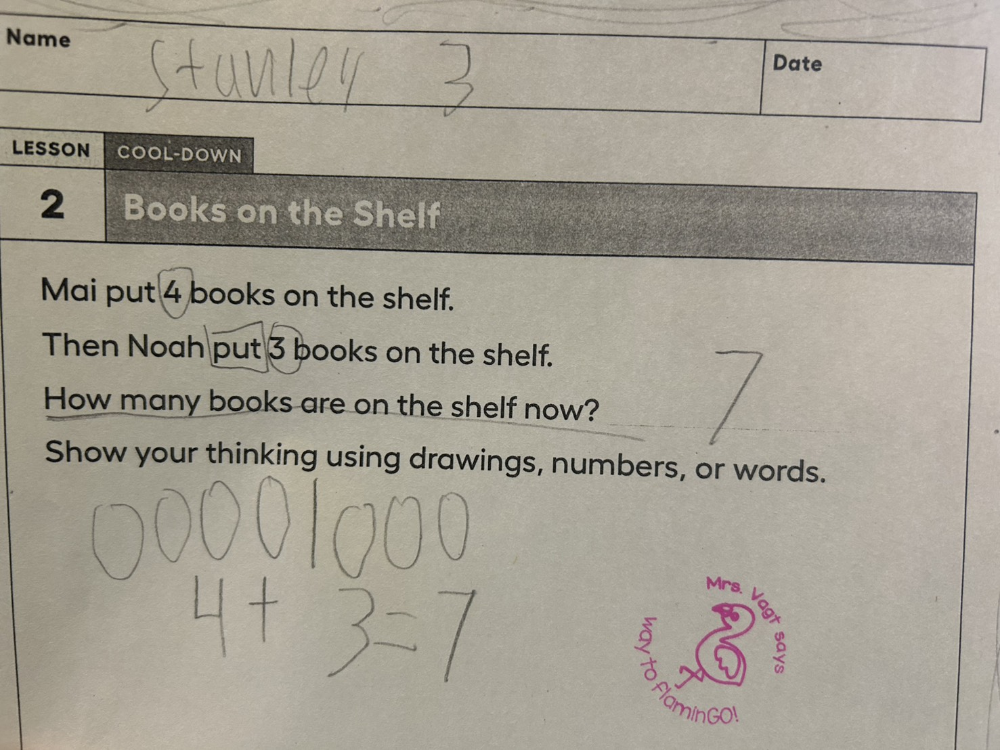

樹樹每天帶回家的數學練習，大多都像這樣：先讀一段對一年級小朋友來說長長的文字，理解題目在說什麼，表達自己的想法，列出算式，最後完成計算。

我很喜歡看他讀著句子，慢慢找出重要的線索，把文字裡描述的事情，轉換成圖畫、數字與符號。對我來說，最有意思的就是這個過程：一道算式，是怎麼從一段話裡長出來的？

這樣的數學教育，真的深得我心。

*這張練習單請孩子用圖畫、數字或文字呈現思考。樹樹留下了閱讀標記、兩組圓圈與算式，讓答案以外的想法也有了可以看見的痕跡。*

## 書架上的七本書，與答案之前的思考

照片裡的題目叫做「Books on the Shelf」。Mai 放了四本書在書架上，接著 Noah 又放了三本，題目問：現在書架上有幾本書？

對大人來說，四加三等於七，很容易。但對正在學習的孩子而言，在寫下算式之前，還有一段值得好好走過的路。

四和三各自代表什麼？兩個人把書放在哪裡？後來的三本，是加入原來的四本嗎？最後問的是其中一個人的書，還是書架上現在所有的書？

照片裡，樹樹圈出了四和三，也標記了動作與最後的問題。他畫出四個圓圈和三個圓圈，中間用一條線分開，再寫下「4 + 3 = 7」。

單靠這張作業，我無法知道他每一步實際思考的順序。但這些留下來的記號，給了我們一起討論的起點：你畫的兩組圓圈各代表什麼？為什麼要把它們加起來？

我尤其喜歡題目最後的要求：用圖畫、數字或文字呈現你的思考。這給孩子好幾種表達理解的方式，也讓大人有機會看見答案是怎麼來的。

## 閱讀理解，是把句子連成一個情境

從語文學習的角度來看，讀懂一道題目，需要的不只是認字或把句子念完。孩子要理解詞語與句子的結構，追蹤人物和動作，連結前後資訊，再確認問題到底在問什麼。

認知心理學以「情境模型」描述讀者在腦中建立的事件與關係表示。應用題的解題歷程還包含下一步：把情境模型轉換成數學模型，找出數量之間的關係。[1]

以這張練習單來說，孩子需要把兩次放書的動作連起來，理解兩組書出現在同一個書架上，才有理由把四與三合併。句子裡的「接著」和「現在」，也幫助他整理事件的順序與問題的時間點。

當我們請孩子用自己的話說一次題意，其實是在給他整理理解的機會：這裡發生了什麼？我們已經知道什麼？還不知道什麼？

## 「數學不好」，可能把不同的困難混在一起

這也讓我想到，有時候孩子應用題做不好，閱讀理解可能是其中一個還沒有得到足夠支持的環節。

孩子可能會算，卻沒有讀懂問題；可能認得每個字，卻還無法把幾個句子的意思連起來；也可能理解故事，但不知道怎麼把數量關係寫成算式。

研究指出，應用題同時涉及閱讀理解、工作記憶與推理能力。[1] 所以，不能把所有困難都歸因於閱讀，也不能看到答案錯了，就直接認定孩子不會計算。

對我而言，這個提醒很實際。如果他卡在題意，我們可以陪他重述或畫圖；如果卡在數量關係，可以拿物件演示；如果關係理解了、計算卻出錯，再回到計算方法練習。

先看見孩子卡在哪裡，才比較知道應該怎麼陪他。

## 圈出關鍵線索，也要理解線索之間的關係

我喜歡樹樹在長句子裡找出記號，但圈出數字或關鍵詞，只是整理資訊的起點。

接下來還要問：這些資訊彼此有什麼關係？

例如，我自己舉一個例子：「小安有八顆糖，比小美多三顆，小美有幾顆糖？」句子裡出現了「多」，要求的卻是小美的數量，所以要用八減三。

孩子需要理解誰比較多、差多少，以及要找的是誰。只記住「看到多就加、看到少就減」，遇到這樣的題目就可能出錯。應用題研究也提醒，依賴表面線索選擇運算，可能跳過了理解情境的過程。[1]

我希望他練習的是，找到線索之後，還能把它們連成有意義的關係，並說明自己為什麼這樣列式。

## 從文字、圖畫到算式，搭起語文與數學之間的橋

這張作業讓我看見，語文與數學可以在同一個學習歷程裡互相支持。

文字描述事件，圓圈呈現數量，算式表達兩組數量合併的關係。孩子可以在這些表徵之間來回檢查：圖畫符合故事嗎？算式符合圖裡的關係嗎？

美國教育科學研究院的國小數學教學指引，將清楚的數學語言、具體與半具體表徵，以及有目的的應用題教學，列為支持學習的重要做法。[2]

這些建議讓我更能說清楚自己喜歡的教學：給孩子可以理解的情境，讓他透過畫圖、物件、說明和符號，逐步建立數學關係。

文字多寡本身並不是品質的保證。若句子超過孩子的理解程度，也可能把數學問題變成閱讀障礙。對還在學英文的孩子，可以透過重述、圖像與實物協助他接近題意，讓語言支持和數學思考一起進行。

## 讓思考留下痕跡，也練習回頭檢查

列出算式、畫出圖，還有一個我很在意的意義：它讓想法留下痕跡。

如果只看最後的七，我們很難知道孩子怎麼想。當圖畫和算式都在紙上，我們就多了可以討論的依據，也比較有機會分辨誤解題意與計算失誤。

這讓我想到「後設認知」：留意思考的過程，檢查自己的理解與策略。陪孩子練習時，可以問：「這個答案放回故事裡，合理嗎？」「你能用另一種方式說明嗎？」

這是我從作業延伸出的陪伴想法，並不是說完成一張練習單，就能證明孩子已經發展出成熟的後設認知。重要的是，我們可以把這些小問題放進日常，讓回頭檢查慢慢成為習慣。

計算熟練度也有價值；同一份教學指引也包含建立流暢度的活動。[2] 我希望熟練與理解一起成長：知道怎麼算，也知道為什麼這樣算。

## 原來，我從小喜歡的就是想明白的那個時刻

看著樹樹的練習，我忽然想起自己小時候。

我最喜歡寫的，就是應用題。讀一段故事，找出線索，想清楚數量之間的關係，再把算式寫出來，對我來說很像解謎。

相較之下，那些一排又一排、反覆練手速的計算題，就很難讓我產生同樣的興趣。我喜歡有一個問題值得想，有一段意思需要理解，最後才找到適合的解法。

原來，我從小喜歡的，就是「想明白」的那個時刻。

現在看著樹樹讀著長長的句子，慢慢把一個情境整理成一道算式，我又看見了自己很喜歡的學習樣子：有故事，有思考，也有理解之後，終於知道該怎麼做的快樂。

## 延伸閱讀與學習紀錄

- 本次練習：「Books on the Shelf」，Lesson 2，Cool-Down。
- 題目情境：四本書放上書架，接著再放三本，求現在的總數。
- 照片可見的紀錄：閱讀標記、兩組圓圈、算式「4 + 3 = 7」。
- [1] [Hickendorff（2021）：The Demands of Simple and Complex Arithmetic Word Problems on Language and Cognitive Resources](https://www.frontiersin.org/journals/psychology/articles/10.3389/fpsyg.2021.727761/full)。討論應用題、語言理解與認知資源。
- [2] [美國教育科學研究院（2021）：Assisting Students Struggling with Mathematics: Intervention in the Elementary Grades](https://ies.ed.gov/ncee/wwc/PracticeGuide/26)。提供數學語言、表徵、應用題與流暢度等教學建議。

本文以家庭作業觀察連結教育研究與個人反思。照片能呈現孩子留下的作答痕跡，無法單獨確定他的完整思考歷程，也不能用來概括所有學校或孩子的學習。
