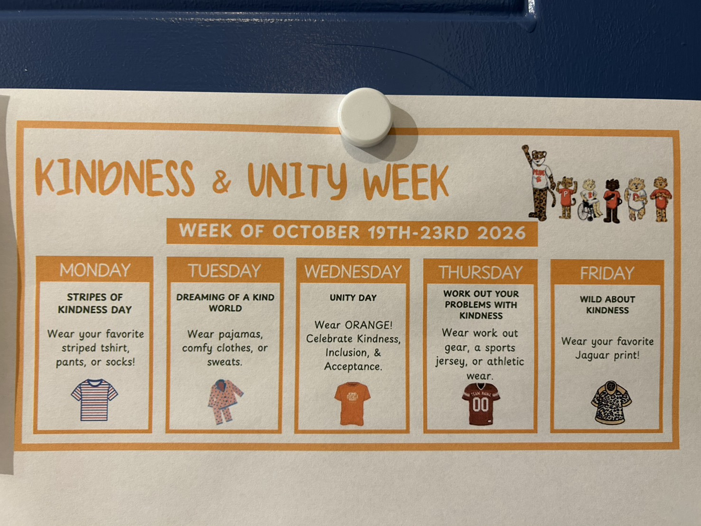

This week, walking Stanley to school has given us something extra to look forward to.

His school is holding Kindness & Unity Week. Each day has a different clothing theme, and as we enter the school grounds, I find myself noticing what the other children are wearing. Our familiar walk has acquired all sorts of things to observe and talk about.

Outside the classroom, the children line up and chat about their outfits while waiting for the teacher to open the door. Standing nearby, watching Stanley talk with his classmates, I find this brief waiting time fascinating. His school day is already taking shape before he enters the classroom.

*The notice connects kindness and unity with a different clothing theme each day. Wednesday’s Unity Day explicitly names kindness, inclusion, and acceptance. The photo documents the activity schedule; the classroom-door scenes below come from my observations while walking Stanley to school.*

## One notice gives each morning a shared conversation starter

The week runs from October 19 to 23, with a different invitation each day:

| Day | Theme | Ways to participate listed on the notice |
| --- | --- | --- |
| Monday | Stripes of Kindness Day | Wear a favorite striped shirt, pants, or socks |
| Tuesday | Dreaming of a Kind World | Wear pajamas, comfortable clothes, or sweats |
| Wednesday | Unity Day | Wear orange to celebrate kindness, inclusion, and acceptance |
| Thursday | Work Out Your Problems with Kindness | Wear workout gear, a sports jersey, or athletic clothing |
| Friday | Wild About Kindness | Wear a favorite jaguar print |

I appreciate how specific the notice is. Stripes can appear on a shirt, pants, or socks; pajama day also welcomes comfortable clothes. Its wording offers several ways to participate using clothing a family may already have.

For parents, clear instructions help us prepare. For children, the daily theme becomes a visible shared experience. Everyone can recognize that they are taking part in the same activity, while looking different from one another.

I did not record the children’s conversations word for word, but I did see them discussing their clothes while waiting. For Stanley, who is still becoming familiar with English and interactions with classmates, something visible that he is also participating in may offer an accessible way into a conversation.

Clothing provides a topic, along with opportunities to communicate through pointing, facial expressions, or short phrases. A child can begin getting to know someone without first preparing a complete introduction.

## When the door opens, each child has a greeting of their own

Another favorite moment comes when the teacher rings the bell and opens the door.

She is dressed for the day’s theme too, welcoming the children at the entrance. Each child has a different way of greeting her: a high five, a hug, or a playful movement they do together.

When Stanley’s turn comes, he makes his heart gesture quickly and delivers a crisp high five. Watching that familiar rhythm makes me smile.

Speed alone cannot tell me how comfortable he feels or how much his social skills have developed. What I can see is that he knows how this exchange works and can respond in turn. It is a small development that I want to keep noticing.

Walking with Mom, chatting in line with classmates, responding to the teacher, and entering the classroom: the morning has a sequence of recognizable transitions. That greeting provides a gentle connection between home life and classroom life.

The teacher’s themed clothing also makes her involvement visible. From a child’s perspective, she is taking part in the same activity. Their relationship gains another small detail they can share.

## Seeing opportunities for practice through social and emotional learning

Social and emotional learning, or SEL, offers one way to understand these moments. CASEL’s framework includes self-awareness, self-management, social awareness, relationship skills, and responsible decision-making, with attention to partnerships among schools, families, and communities.[1]

Talking about outfits offers practice in sharing and listening; waiting involves attending to the group’s rhythm; greeting the teacher creates an opportunity for connection. I am using the framework to interpret daily life. This does not establish that the school uses a particular SEL curriculum or that Stanley has mastered these abilities.

I am especially interested in what happens afterward. Does he let a classmate finish speaking? How does he respond to someone whose outfit differs from his? If a child has not dressed for the theme, do the others still invite that child into the conversation?

The meaning of kindness may become clearer through those interactions. Wearing a shared color provides a beginning; treating people kindly requires continued practice.

## Motivation: “I know how to do this, and I have people to connect with”

Self-Determination Theory offers another perspective through autonomy, competence, and relatedness.[2]

This week suggests several possibilities worth noticing. Choosing an outfit within a theme may allow personal expression. Completing a familiar greeting may provide an experience of knowing what to do. Responses from classmates and a teacher’s welcome may support connection.

These are directions for observation, rather than evidence that the activities have changed Stanley’s motivation. I can continue noticing whether he brings up tomorrow’s theme, shares interactions with classmates, and tells us how he feels about school.

Participation can also look different across children. Some join a gesture immediately; others need to watch several times. Having room to join at a comfortable pace may help participation reflect a child’s own willingness.

## Understanding the background of these activities

At first, a week of themed clothing simply looks fun. Reading further helped me understand that the orange day has a specific advocacy background.

PACER’s National Bullying Prevention Center launched Unity Day in 2011. Wearing and sharing orange communicates kindness, acceptance, inclusion, and bullying prevention. In 2026, Unity Day falls on October 21, the Wednesday shown on the school notice.[3]

Orange offers a visible shared symbol and an accessible way to engage with abstract values. The school’s wording echoes the initiative; understanding how the entire themed week was developed would require more information from the school.

One week cannot represent every American school. Practices vary across regions, schools, and classrooms. In this particular school, I see values presented in a notice, translated into actions children can take, and given meaning through everyday interactions with teachers and peers.

This gives me one way to understand our local school culture: shared activities create occasions to meet, recognize one another, and exchange experiences. Their meaning becomes clearer when I look at what actually happens between people.

## From movie night to the Harvest Party, families have ways to take part

There is also a movie night this evening. Next Friday, October 30, brings the costume parade and the first-grade Harvest Party.

These are separate events with their own arrangements. Kindness & Unity Week has its theme, movie night offers another gathering, and next week’s parade and party have a separate notice. I am recording them together because, in our family’s experience, they are gradually forming a picture of school life.

Next Friday’s costume parade runs from 1:20 to 1:50 p.m., with parents invited to watch from the gym. The Harvest Party follows from 1:50 to 3:00 p.m., with games, crafts, and a snack in the first-grade classrooms. The notice distinguishes between watching the parade and helping in class: classroom volunteers must sign up and have district approval.

There are requests for snacks, supplies, and prizes, along with volunteer assignments for different stations. These details reveal the coordination behind an event children anticipate: what is needed, who will prepare it, when it should arrive, and who will lead each activity.

I do not have the full movie-night schedule, so I am recording that it is happening tonight without describing an experience we have not yet had. Together, these invitations are helping me see school as a setting our family can gradually get to know and join.

## We are learning alongside our child how to become part of this community

For our family, settling into life in the United States involves many small learning experiences.

We learn to read an activity notice and work out what needs preparation and what we may choose to attend. We learn the different roles involved in a parade, a party, or volunteering. We learn that we can ask questions and choose ways to contribute that fit our time and capacity.

We did not understand all of this on the day we arrived. Following our child’s school calendar, we understand a little more and participate a little more, gradually becoming familiar with our surroundings.

While Stanley chats with classmates outside the classroom, I am learning nearby. How do children join a group? How does the teacher welcome each child? How does an event show parents what they can do? How might we respond to these invitations in our own way?

Increasingly, I see becoming part of a community as both understanding other people’s customs and finding a place where we want to participate. Our languages, family memories, and ways of living remain with us. New experiences add connections to that life.

Children and parents have different things to become familiar with. Sometimes Stanley is already exchanging a heart gesture and a high five quite naturally while I am still watching closely to understand how the interaction unfolds. We really are learning together, with different experiences and different timelines.

## What I want to record is how he gradually participates

When writing about learning, it is easy to focus on what a child has made or what problem he has solved. Now I also want to leave space for these brief interactions.

Can he find a conversation starter? Does he want to respond to a classmate? Does he know what he can do when his turn comes? When an arrangement is unfamiliar, does he observe, ask a question, or watch from the side for a while?

These observations do not need to become assessments. Recording them can help me understand how my child experiences his surroundings without converting every activity into a measurable outcome.

I also want to recognize different forms of participation. Being animated, moving quickly, and talking a lot are only some possibilities. A response after quiet observation, or a small question offered to a classmate, may also be a step worth appreciating.

Understanding whether these activities help him become kinder or develop a stronger sense of belonging takes time. I am willing to begin with the details I can see each day, leaving room for his experience to unfold.

## Before he enters the classroom, there are already people and moments to look forward to

The image that stays with me this week is still the one at the classroom door.

The children chat about their clothes and wait for the bell. The door opens. Their teacher, dressed for the same theme, greets each child. Stanley takes his turn, makes a quick heart gesture, and exchanges a crisp high five.

Then he enters the classroom and begins his day.

I enjoy the fun these arrangements bring. I also appreciate their reminder that, alongside learning academic content, children are learning how to interact, express themselves, and participate in a place they share with others.

Walking this short distance with him, gradually understanding and joining in, I am gathering new experiences for our family too.

Eventually, I may forget which outfit belonged to which day. What I want to remember is that, as we were becoming familiar with our new life, Stanley had classmates to chat with outside the classroom—and a teacher ready to make a heart gesture with him.

## Further reading and observation record

- Observation dates: October 19–23, 2026.
- Setting: Juanita Elementary school grounds and the first-grade classroom entrance.
- Sources: family observations during morning drop-off, the photographed Kindness & Unity Week notice, and the school’s October 30 costume parade and Harvest Party announcement.
- Timing: at the time of writing, we have not yet attended movie night or the October 30 events. Those sections describe known arrangements and anticipation.
- [1] [CASEL: What Is Social and Emotional Learning?](https://schoolguide.casel.org/what-is-sel/what-is-sel/) Introduces core competencies and connections among schools, families, and communities.
- [2] [Center for Self-Determination Theory: The Theory](https://selfdeterminationtheory.org/the-theory/) Explains autonomy, competence, relatedness, and the role of social contexts in motivation.
- [3] [PACER’s National Bullying Prevention Center: Unity Day](https://www.pacer.org/bullying/nbpm/unity-day/) Describes the initiative’s origins, the meaning of orange, and the 2026 date.

This article connects a parent’s everyday observations with learning theory and personal reflection. Theory offers ways to interpret experiences and guide further observation. These brief encounters cannot establish the activities’ effects or represent the experiences of every American school, family, or child.
